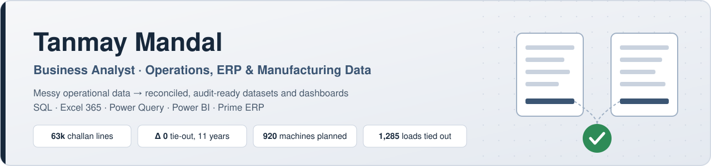

  

  
  <!--  -->
  
  

I take messy operational data — delivery challans, stock ledgers, purchase orders, freight bills — and turn it into **reconciled, traceable datasets and dashboards that operations and finance teams can act on**. My work is built for audit: every number ties back to a source row, and exceptions are logged, not silently fixed.

**Background:** Business Analysis, Operations & ERP (Prime ERP) at a garment manufacturer · freelance reconciliation and analytics for an industrial distributor and a 10-truck logistics fleet · BBA, Amity University Ranchi (2024)

---

## ⭐ Real-world work

Built on real business data (anonymised before publishing).

| Project | Problem | What I built | Result |
|---|---|---|---|
| **[Inventory Reconciliation](https://github.com/tanmaymandal0207-cmyk/inventory-reconciliation)** Excel · Power Query | 11 years of hand-typed challans and stock ledgers that nobody could reconcile | Flattened 63,360 challan lines, mapped 2,425 parts to a master, evidenced cancellations, consolidated all years with an audit register | **Δ 0 tie-out every year** · 116 findings logged |
| **[Garment PPC System](https://github.com/tanmaymandal0207-cmyk/garment-ppc-system)** Excel 365 | Will each PO ship on time, and do we have the machines for the line plan? | Order planner (`WORKDAY.INTL` scheduling, OTIF) + machine capacity planner (26 lines × 105 days) | 191 POs scheduled · demand vs **920 installed machines** by group |
| **[Commercial Intelligence Dashboard](https://github.com/tanmaymandal0207-cmyk/Commercial-Intelligence-Dashboard)** Power BI · DAX | Which products drive revenue, are we pricing well, and which are declining? | 5-page report, 30 DAX measures, lifecycle & risk classification | 7 years · 540 SKUs · ₹41.97 Cr analysed |
| **[Logistics Expense Tracker](https://github.com/tanmaymandal0207-cmyk/logistics-expense-tracker)** Excel 365 | Hand-typed monthly totals that didn't match the load register (9 of 28 months off) | Structured tables, `SUMIFS` reconciliation, year-filtered fleet dashboard | 1,285 loads **tied out to the rupee** |

## 🧮 SQL & analytics

| Project | Focus | Tools |
|---|---|---|
| **[SQL Business Problems](https://github.com/tanmaymandal0207-cmyk/sql-business-problems)** | Case studies written as problem → SQL → validation → recommendation, across revenue risk, margin, supply chain and data quality. [Start with these five →](https://github.com/tanmaymandal0207-cmyk/sql-business-problems#start-here) | BigQuery SQL |
| **[Zomato Bangalore Analysis](https://github.com/tanmaymandal0207-cmyk/zomato-bangalore-sql-analysis)** | Found that 51,717 listings are only 12,453 restaurants — per-row metrics were inflated ~4×; rebuilt the analysis at restaurant grain | BigQuery SQL |
| **[Superstore Sales Analysis](https://github.com/tanmaymandal0207-cmyk/superstore-sales-analysis-sql-powerbi)** | Sales, margin and discount-cost drivers, SQL-cleaned and modelled in Power BI | MySQL · Power BI |
| **[IPL Match Intelligence](https://github.com/tanmaymandal0207-cmyk/IPL-Match-Intelligence-Player-Impact-Analysis)** | Practice project: what wins IPL matches · [live dashboard](https://tanmaymandal0207-cmyk.github.io/IPL-Match-Intelligence-Player-Impact-Analysis/dashboard/) | MySQL 8 |

## 🔍 How I work

- **Reconcile before reporting** — totals tie to source, joins are tested for row inflation, nulls and duplicates are counted first.
- **Traceability** — every cleaned row keeps a pointer to its source; originals are kept, not overwritten.
- **Exceptions are visible** — mismatches go into a findings log with evidence instead of being patched.
- **Built for handover** — structured tables, documented formulas and data dictionaries so the next person can run it.

## 🛠️ Toolkit

  
  
  
  
  

**Domain:** production planning & control · inventory & challan reconciliation · master-data mapping · freight & fleet cost · data-quality and exception reporting
